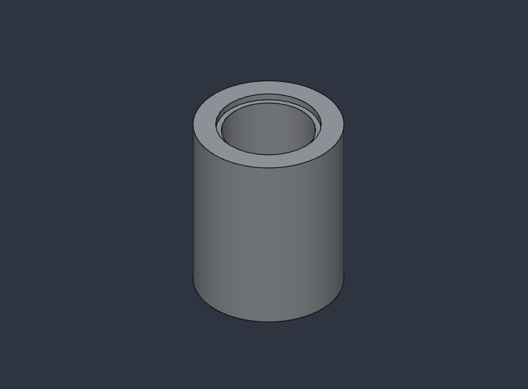
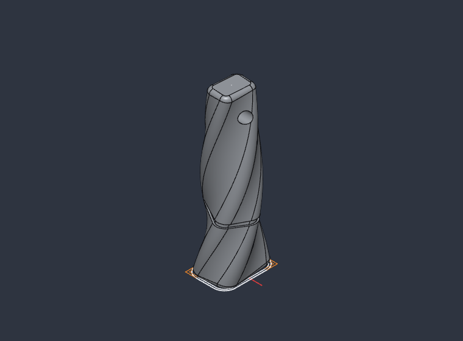
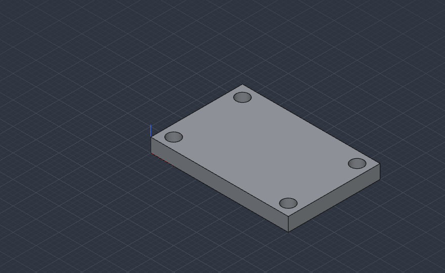

# My Reproduction Notes & Scripts（我的复现笔记与脚本）

> 本目录内容为本人（Yeai-ui）在复现
> [anteloc/ldraw-nova](https://github.com/anteloc/ldraw-nova)（v0.6.0）过程中
> 产生的笔记、脚本与产出，与上游代码分开存放，不影响原项目。

## Contents

### 复现报告（Markdown）

| 文件 | 说明 |
|---|---|
| LDraw-Nova-复现手册-v1.md | 复现环境搭建手册 |
| LDraw-Nova-复现进度报告-v2.md | 复现进度报告 v2 |
| LDraw-Nova-复现项目-完整整合报告.md | 全流程整合报告 |
| LDraw-Nova-快速命令卡-v1.md | 常用命令速查 |
| LDraw-Nova-路线B实现手册-v2.md | 路线 B（本地非 Docker）实现手册 |
| LDraw-Nova-路线B搭建记录-v3.md | 路线 B 搭建过程记录 v3 |
| _appendix_v32.md | 附录笔记 |

### 辅助脚本（Python）

| 文件 | 说明 |
|---|---|
| probe_all.py | 魔搭免费模型池批量探测 |
| tool_test.py | 工具链测试 |
| vlm_test.py / vlm_test2.py / vlm_test3.py | VLM 相关测试 |
| verify_parts.py | 零件文件校验 |
| part_query.py | 零件查询 |

### 产出物（outputs/）—— AI 建模成果与工具链集成

#### outputs/videos/ — 装配动画（Blender 渲染管线产出）

| 文件 | 说明 |
|---|---|
| part-lego-final.mp4 | 零件乐高化最终装配动画 |
| bracket-assembly.mp4 | 支架装配动画 |
| noodle-assembly-build.mp4 | 面馆模型搭建动画 |
| huawei-logo.mp4 / logo-n.mp4 | LOGO 建模动画 |

生成链路：**LeoCAD 渲染逐帧 → 本地 Blender 4.2.9（`render_video_blender.py` / `make_assembly_video.py` 调用）合成视频**。
Blender 与 SolidCraft 软件本体不随仓库分发，请自行下载安装。

### ✨ AI 应用能力：LLM 驱动的参数化 CAD 建模（SolidCraft MCP）

**全程纯对话驱动、零人工建模**：用大模型通过 **SolidCraft 0.27.0 MCP 外挂**
（Apache-2.0 / MIT，本地 portable 运行）直接生成可制造的机械零件。
工作流：自然语言需求 → LLM 生成参数化 `.sc` 场景 → 求解器装配校验 → 一键导出 `.step` / `.stl`（可直接进 CAM / 3D 打印）。

| AI 生成零件 | 建模要点 | 导出格式 |
|---|---|---|
| Step01_Bushing 衬套 | 含倒角工艺处理，另做了倒角抑制对比实验 | `.sc` + 渲染图 |
| plate_60x40x6_m5 板件 | 60×40×6 板材 + M5 螺纹孔，参数全部由 LLM 生成 | `.step` / `.stl` |
| Gear m2 z20 齿轮 | 模数 2、齿数 20 的参数化齿轮 | `.sc` |
| handle 手柄系列 | L90/T180 多参数变体迭代 + 导轨装配实验 | `.sc` / `.step` |
| bracket 支架 | 与 ldraw-nova 产出联动，走完"AI 建模 → 实体导出"全链路 | `.step` / `.stl` |

AI 生成效果截图（LLM 生成、SolidCraft 渲染，无人工修型）：

更多产出见 [`outputs/solidcraft/ai-builds/`](outputs/solidcraft/ai-builds/)。
注：部分涉及机密的模具类产出（part03 系列）未上传，仅保留在本地。

#### outputs/scripts/ — 建模与视频脚本

| 文件 | 说明 |
|---|---|
| render_video_blender.py | Blender 视频渲染调用 |
| make_assembly_video.py | 装配动画合成 |
| generate_noodleshop.py | 面馆场景生成 |
| generate_kiosk.py / generate_kiosk_v2.py | 售货亭模型生成 |
| logo_n.py / logo_huawei.py | LOGO 生成 |
| mesh2ldraw.py | 网格转 LDraw |
| check_geom.py / check_support.py | 几何/支撑检查 |

#### outputs/models/ — AI 生成的 LDraw 模型（.mpd）

noodleshop.mpd（面馆）、kiosk_v2.mpd（售货亭）、bridge-test.mpd、noodle-flat.mpd。
按项目规范，生成模型内嵌 `0 !LICENSE CC-BY-NC`（非商用，署名 AI 作者）。

## Attribution

- Upstream project: [anteloc/ldraw-nova](https://github.com/anteloc/ldraw-nova) by Carlos Antelo
- Upstream license: AGPL-3.0（代码）/ CC BY-SA 4.0（文档与笔记）
- Changes: 新增 `my-reproduction/` 目录（复现笔记、脚本、SolidCraft 联动产出、
  Blender 视频管线产出、AI 生成模型），未修改上游任何代码。
- 工具链：Blender 4.2.9（GPL-2.0+，本地安装未捆绑）、SolidCraft 0.27.0（Apache-2.0/MIT，本地 portable，未捆绑）。
